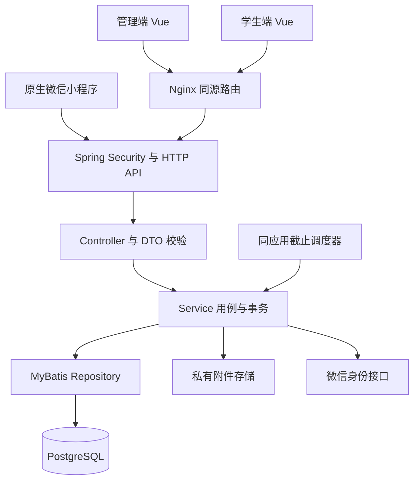
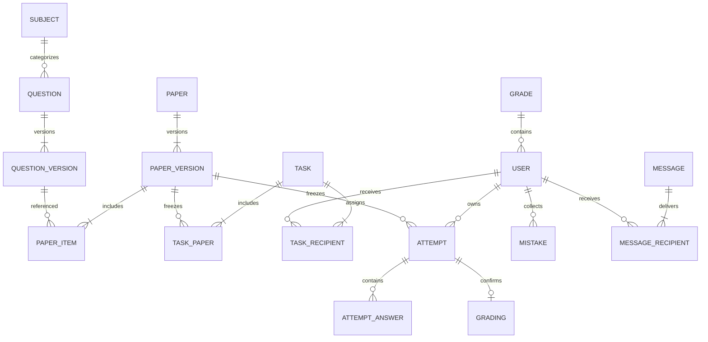
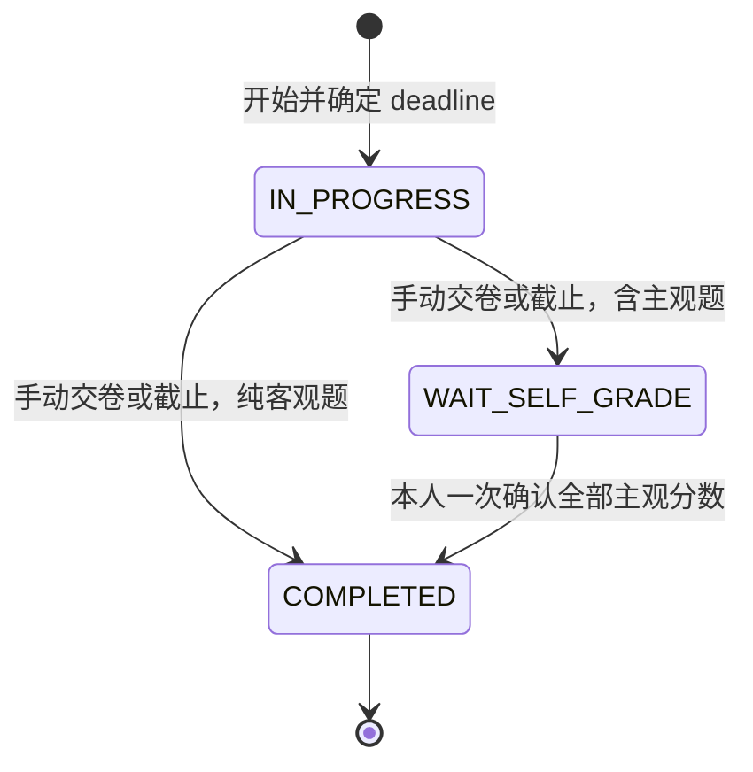

# Design

## Context

动机见 proposal.md。当前仓库的 server.cjs 仅提供静态文件，exam-core.js 内置五道单选题并在浏览器计分，app.js 保存本地进度，tests/exam.test.cjs 覆盖倒计时、计分和存档校验。现有主规格为空，五项旧 change 均未勾选实施任务。

### 参考证据

参考版本为 xzs 3.9.0，固定 commit 为 `0664766be421e01b723585fc93fd7dc9d0225e18`，提交时间 2026-11-10 06:12:50 UTC，检查日期 2026-11-10。以下均为已查阅的固定版本源文件，分析方式为静态阅读。

| 证据 | 已确认事实 |
| --- | --- |
| [README](https://github.com/mindskip/xzs/blob/0664766be421e01b723585fc93fd7dc9d0225e18/README.md) | 管理、学生 Web、微信三端，五类题型、三类试卷和消息等功能 |
| [源码目录](https://github.com/mindskip/xzs/tree/0664766be421e01b723585fc93fd7dc9d0225e18/source) | source/xzs、source/vue/xzs-admin、source/vue/xzs-student、source/wx/xzs-student |
| [管理路由](https://github.com/mindskip/xzs/blob/0664766be421e01b723585fc93fd7dc9d0225e18/source/vue/xzs-admin/src/router.js) | 用户、学科、卷题、任务、答卷、消息、日志、主页和资料入口 |
| [学生路由](https://github.com/mindskip/xzs/blob/0664766be421e01b723585fc93fd7dc9d0225e18/source/vue/xzs-student/src/router.js) | 试卷中心、答题、批改、回看、记录、错题、资料和消息 |
| [小程序页面](https://github.com/mindskip/xzs/blob/0664766be421e01b723585fc93fd7dc9d0225e18/source/wx/xzs-student/app.json) | 注册绑定、试卷、记录、我的、消息和日志页面 |
| [交卷 Controller](https://github.com/mindskip/xzs/blob/0664766be421e01b723585fc93fd7dc9d0225e18/source/xzs/src/main/java/com/mindskip/xzs/controller/student/ExamPaperAnswerController.java) | answerSubmit 调用计算服务并发出事件，edit 确认批改，read 读取试卷和答案 |
| [计分 Service](https://github.com/mindskip/xzs/blob/0664766be421e01b723585fc93fd7dc9d0225e18/source/xzs/src/main/java/com/mindskip/xzs/service/impl/ExamPaperAnswerServiceImpl.java) | 单选判断多选自动计分，填空简答待批改；任务卷按试卷和用户查重 |
| [任务 Service](https://github.com/mindskip/xzs/blob/0664766be421e01b723585fc93fd7dc9d0225e18/source/xzs/src/main/java/com/mindskip/xzs/service/impl/TaskExamServiceImpl.java) | 一个任务通过 paperItems 关联多张卷，试卷保存 taskId |
| [试卷 Service](https://github.com/mindskip/xzs/blob/0664766be421e01b723585fc93fd7dc9d0225e18/source/xzs/src/main/java/com/mindskip/xzs/service/impl/ExamPaperServiceImpl.java) | 试卷结构存 TextContent，读取时组装题目；修改会更新文本内容 |
| [微信认证](https://github.com/mindskip/xzs/blob/0664766be421e01b723585fc93fd7dc9d0225e18/source/xzs/src/main/java/com/mindskip/xzs/controller/wx/student/AuthController.java) | 平台凭据加微信 code 绑定，checkBind 登录，unBind 解绑 |
| [数据库脚本](https://github.com/mindskip/xzs/blob/0664766be421e01b723585fc93fd7dc9d0225e18/sql/xzs-postgresql.sql) | 13 张业务表，覆盖试卷、答卷、逐题答案、任务、任务完成、题目、学科、文本、用户、令牌、消息、收件人和用户日志 |
| [POM](https://github.com/mindskip/xzs/blob/0664766be421e01b723585fc93fd7dc9d0225e18/source/xzs/pom.xml) | 项目版本 3.9.0，原栈 Java 8、Spring Boot 2.1.6、MyBatis、PostgreSQL |

### 已确认决定与补充设计

用户在本次问答确认三项决定。任务包含多张卷，每位学生每张任务卷一次。服务端保存草稿、到期冻结、历史版本留存。新 change 统一承接完整范围。

由参考源码确认的行为包括五题型、三卷型、客观题自动判分和主观题自行批改、微信绑定和站内消息。以下是本项目的补充设计基线，不能表述为参考项目已实现的保证。

- 任务发布冻结资格，时段采用左闭右开区间，版本不可变，数据库唯一约束保护跨端并发。
- 多选按集合比较，所有分数使用整数百分之一分，未答主观题在确认时固定零分。
- 微信绑定一对一、私有图片授权、即时会话撤销、附件限额、保存冲突提示。
- 题库上限、考试时长上限、统计时区与恢复目标采用 specs 中明确的拟议参数。
- 前端升级至 Vue 3，后端采用 Java 21 与 Spring Boot 3.5 系列，具体选择见下文。

### 与旧规划的替代关系

| 旧 change | 新规格承接 | 本次决定 |
| --- | --- | --- |
| design-exam-product | client-experience 及各业务规格 | 三端生产页面纳入实施，任务按卷一次，客观卷交卷直接完成 |
| build-exam-backend | 全部业务规格、platform-delivery | Java 分层单体承接 Fastify 设计，API 及数据库以本设计为准 |
| secure-exam-platform | identity-access、question-bank、platform-delivery | Web 采用服务端会话，小程序使用可撤销令牌，保留归属校验和内容安全要求 |
| verify-exam-platform | platform-delivery 和全部 Scenario | 每个场景到测试或真机验收证据，按闭环完成 |
| operate-exam-platform | platform-delivery | 单 Java 运行单元含截止调度，PostgreSQL、私有附件及独立 Web 服务 |

这些旧 change 是历史规划材料，本 change 的实施不依赖它们先完成或归档。它们的任务进度不能合并为本 change 的已完成项。实施入口文档须引用本 change，旧 change 的主规格归档须先处理重复 capability，避免覆盖新定义。

## Goals / Non-Goals

### Goals

以明确的数据所有权、事务和版本约束支持跨端一致的考试闭环，提供可复现交付及可定位验收证据。所有功能均有真实页面、授权接口和持久化数据。

### Non-Goals

本期边界为用户列出的考试平台功能。AI 阅卷、远程监考、教师角色、支付、业务导入导出及现存 xzs 生产数据导入属于后续需求。小程序错题独立页面可后续增加，本次错题入口位于学生 Web，相关答卷仍可在小程序回看。

## Decisions

### 1. 分层单体及版本基线

| 组件 | 规划版本 | 锁定方式 |
| --- | --- | --- |
| Java | 21 LTS | 工具链与运行镜像固定补丁及摘要 |
| Spring Boot | 3.5.16 | Maven parent 固定版本 |
| Spring Security、HikariCP、Jackson、PostgreSQL JDBC、Flyway | Boot 3.5.16 BOM 管理 | effective-pom 与依赖清单记录实际解析版本 |
| MyBatis Spring Boot Starter | 3.0.x | 首个基础任务核验兼容补丁并固定，适配 Boot 3.2–3.5 |
| PostgreSQL | 17.x | 部署镜像固定补丁及摘要 |
| Vue、Vue Router、Pinia、Element Plus | 3.5.x、4.x、3.x、2.x | npm lock 固定精确版本 |
| TypeScript、Vite、Node.js | 5.x、7.x、22.x 且至少 22.12 | 构建工具链固定补丁，Node 仅作前端构建 |
| KaTeX、ECharts | 0.16.x、5.6.x | 锁定依赖，公式在两端验证 |
| 微信小程序 | 原生 WXML/WXSS/JS，基础库 3.x | 体验版验证时固定实际最低可用基础库 |

这是规划兼容系列，带 x 的依赖在基础任务中解析为精确补丁并记录构建证据，后续构建禁止浮动安装。版本升级若改变外部行为须同步规格。Boot 3.5 与 Java 21、MyBatis 3.0 的兼容关系依据官方文档，Vue 3 为当前主要开发版本。[Spring Boot](https://docs.spring.io/spring-boot/3.5/system-requirements.html)、[MyBatis](https://mybatis.org/spring-boot-starter/mybatis-spring-boot-autoconfigure/)、[Vue](https://vuejs.org/about/faq)

选择新版本框架以使用当前 API 和依赖管理。沿用 Java 8/Vue 2 会扩大后续升级工作，本次只将其作为参考源码的版本背景。分层单体让答卷冻结、计分和任务进度共用数据库事务，独立前端保持部署边界。



目录规划如下。

```text
backend/
  pom.xml
  src/main/java/.../exam/
    configuration/ controller/ service/ repository/
    domain/ dto/ security/ scheduling/ storage/
  src/main/resources/mapper/
  src/main/resources/db/migration/
  src/test/
web/
  admin/src/{views,api,router,stores,components}
  student/src/{views,api,router,stores,components}
  shared/                         题型呈现、API 类型和基础交互
wechat/student/
  pages/{auth,tasks,papers,exam,records,profile,messages,activities}
  components/ services/ utils/
deploy/                           Compose、Nginx、环境样例
docs/{api,data,product,verification,operations}
scripts/{test.ps1,gate.ps1}
```

Controller 做传输和边界校验，Service 执行权限、状态规则及事务，Repository 承载参数化 SQL。安全模块给出当前主体，Service 每次重新确认资源所有权。DTO 与持久化实体分开，作答 DTO 白名单不含答案解析。

### 2. 数据关系与约束



| 表族 | 关键字段与约束 |
| --- | --- |
| users、grades、profiles | username_normalized 唯一，role 为 STUDENT/ADMIN，status 为 ENABLED/DISABLED/DELETED，profile.user_id 唯一 |
| sessions、wechat_bindings、wechat_tokens | 会话摘要、过期和撤销时间，绑定 appid/openid 唯一且 user_id 唯一，令牌只存摘要 |
| subjects | grade_id 外键，年级和规范名称唯一，被题目/试卷引用时删除 RESTRICT |
| questions、question_versions | 版本号与 question_id 联合唯一，版本包含净化题干、选项、答案、解析、score_minor、附件引用 |
| papers、paper_versions、paper_items | paper_type 固定为 FIXED/TIMED/TASK，发布版本不可变，item 固定 question_version_id、position、score_minor，同卷版本位置唯一 |
| tasks、task_papers、task_recipients | 发布时冻结成员与卷版本，task_papers.paper_id 唯一，task_id/user_id 资格唯一 |
| attempts | owner_id、paper_id、paper_version_id、task_id、status、started_at、deadline_at、version、final_score_minor；task_id 非空时部分唯一索引 (owner_id,paper_id) |
| attempt_answers、gradings | 每答卷每题唯一，主观成绩只能确认一次，grading.attempt_id 唯一并记录 SELF 来源 |
| mistakes | (owner_id,question_id) 唯一，关联最近错误的 attempt_id 与 question_version_id，后续正确结果不删除 |
| messages、message_recipients | 正文发布后不可变，(message_id,user_id) 唯一，read_at 仅首次赋值 |
| attachments、attachment_links | 随机存储键、类型、大小、摘要、所有者；引用归属到题目版本或头像 |
| idempotency_records、audit_events | 主体/动作/键唯一、载荷摘要及结果；审计只追加且脱敏 |

标识采用 UUID，业务时间使用 timestamptz，服务端 UTC 运算，界面及统计使用 Asia/Hong_Kong。分值用整数百分之一分，API 以两位十进制字符串表达。对内容编辑使用 version 条件更新。软删除主记录保留引用，账号删除撤销会话并对资料匿名化，历史所有者标识保留。发布版本不做普通物理删除。

参考 SQL 的 t_text_content 承载多种 JSON 文本，本设计将结构化关系放到独立表，富文本题干使用约束 JSONB/HTML 内容字段，以便外键和唯一性约束直接保护业务。

### 3. 状态、事务与截止



草稿内容为 DRAFT → PUBLISHED → ARCHIVED，发布后修改生成独立新 DRAFT。已发布任务内容冻结，任务完成进度由各卷状态推导。消息成功发送后为 SENT，收件状态 UNREAD → READ。账号 ENABLED ↔ DISABLED → DELETED。

- 开始事务检查资格、账号状态、发布版本和时间。任务卷 INSERT 遇唯一冲突读取原答卷。普通练习新开始生成新答卷，已有答卷恢复走显式读取接口。
- 答案保存以答卷 version 做条件更新并增加版本，未知题目或无效选项整体拒绝。请求文本每题至多 10000 字符，整份载荷至多 2 MiB。
- 手动提交使用完整最终答案及 expectedVersion。锁定答卷后取数据库实际当前时间，校验 deadline，原子保存、冻结、客观计分，纯客观卷同时生成错题和完成结果。锁等待结束后重新取时间，避免截止前排队请求截止后补写。
- 截止调度每 5 秒扫描到期答卷并按锁竞争处理。读取、保存及提交也调用同一截止检查。服务端宕机后恢复会冻结原先持久化草稿，截止时间不延长。冻结后按服务端提交记录返回最终结果。
- 自行批改事务校验全套主观题分数、答卷归属和 version，写唯一 grading，更新逐题得分、总分、错题和任务进度。空主观答案固定零分，其余允许学生依据参考答案自评。
- 核心业务写入及审计在同一事务，异常整体回滚。文件和微信 HTTP 调用在数据库事务外执行。附件上传先暂存，关联成功才可读，过期无引用对象由清理任务回收。
- 幂等记录保留 24 小时，键为主体、操作和 Idempotency-Key，记录请求摘要。超期后的任务答卷唯一约束、终态约束和 grading 唯一约束仍保护一次性效果。并发执行中的相同键返回操作处理中及重试建议。

### 4. 接口契约

基础路径为 /api/v1。管理接口位于 /admin，个人数据位于 /me。JSON 响应为 `{code,message,data,requestId}`，code=0 成功。错误码固定为 VALIDATION_ERROR、UNAUTHENTICATED、FORBIDDEN、NOT_FOUND、VERSION_CONFLICT、ALREADY_COMPLETED、EXAM_CLOSED、BINDING_CONFLICT、RATE_LIMITED、DEPENDENCY_UNAVAILABLE。HTTP 分别映射 400、401、403、404、409、409、409、409、429、503。客户端以 code 判断业务结果，并处理无法获取 JSON 的传输失败。

页码从 1 开始，pageSize 默认 20、最大 100，排序字段逐资源白名单并追加 id。日期传 ISO8601，分数传十进制字符串。敏感字段错误只返回安全提示。变更请求携带 expectedVersion，创建答卷、交卷、批改和发消息带 Idempotency-Key。

| 操作族 | 方法与路径 | 输入及结果 |
| --- | --- | --- |
| 年级目录 | GET /catalog/grades | 注册可匿名读取启用年级标识与名称 |
| 注册登录退出 | POST /auth/register、POST /auth/login、POST /auth/logout | gradeId/username/password；返回安全账号视图和会话 |
| 当前用户 | GET /me、PATCH /me/profile、POST /me/avatar | 可编辑资料及图片；返回 ProfileVM |
| 密码变更 | POST /me/password | 当前密码与新密码，成功后撤销全部会话并重新登录 |
| 微信身份 | POST /auth/wechat/bind、POST /auth/wechat/login、DELETE /auth/wechat/binding | 新 code，绑定时加平台凭据；返回可撤销 token |
| 账号 | GET/POST /admin/users、GET/PATCH/DELETE /admin/users/{id}、POST /admin/users/{id}/disable 或 enable | 角色、年级筛选；角色和状态仅管理员变更 |
| 学科题目 | GET/POST /admin/subjects 或 questions、GET/PATCH/DELETE /admin/subjects/{id} 或 questions/{id} | 列表及带版本的编辑对象 |
| 图片 | POST /attachments、GET /attachments/{id} | multipart 文件、业务引用；授权后二进制内容 |
| 试卷 | GET/POST /admin/papers、GET/PATCH/DELETE /admin/papers/{id}、POST /admin/papers/{id}/publish | 分组题目、时长、类型、开放区间；返回发布版本 |
| 任务 | GET/POST /admin/tasks、GET/PATCH/DELETE /admin/tasks/{id}、POST /admin/tasks/{id}/publish | 年级、paperIds；返回冻结成员数及卷列表 |
| 可用内容 | GET /me/papers、GET /me/papers/{id}、GET /me/tasks、GET /me/tasks/{id} | 仅返回本人可见内容，时段未开放展示元信息 |
| 开始答卷 | POST /me/papers/{id}/attempts、POST /me/tasks/{taskId}/papers/{paperId}/attempts | 创建或恢复；返回 id、status、serverNow、deadlineAt、version、题目及已保存答案 |
| 草稿与交卷 | GET /me/attempts/{id}、PUT /me/attempts/{id}/answers、POST /me/attempts/{id}/submit | expectedVersion、answerItems；提交返回暂定或最终成绩和状态 |
| 自行批改 | POST /me/attempts/{id}/self-grade | expectedVersion、questionId/score 数组；返回最终结果 |
| 学习记录 | GET /me/attempts、GET /me/mistakes、GET /me/mistakes/{id} | 分页、学科、状态；历史快照与个人错题 |
| 管理成绩 | GET /admin/attempts、GET /admin/attempts/{id} | 用户、学科、试卷、状态筛选；成绩及回看 |
| 消息 | POST /admin/messages、GET /admin/messages、GET /admin/messages/{id} | 收件人、标题、正文；发送结果及已读人数 |
| 个人消息 | GET /me/messages、GET /me/messages/{id}、PUT /me/messages/{id}/read | 本人消息，首次阅读时间 |
| 动态日志统计 | GET /me/activities、GET /admin/audit-events、GET /admin/statistics | 分页动态、脱敏日志、含周期时区的统计 |

答案联合类型为 Single/TrueFalse 的 optionId、Multiple 的 optionIds、Gap 的 texts、Short 的 text。题目 DTO 标识稳定题目版本，服务器从答卷快照找分值，不接受客户端 correct、score 或目标 status。交卷返回 status、automaticScore、finalScore（待批改时为空）、version，待批改仅在本人授权回看时返回参考答案。

### 5. 功能对照表

A 表示管理 Web 路径 /admin 下，S 表示学生 Web /student 下，W 表示小程序 pages 下。表内 API 省略 /api/v1，场景编号可在相应 capability/spec.md 查找，同 Requirement 的 F/B 场景同时纳入验收。

| 参考功能 | capability | 页面 | API | 代表场景 |
| --- | --- | --- | --- | --- |
| 管理员登录 | identity-access | A /login | POST /auth/login | IA01-N、IA02-F |
| 学生注册登录退出 | identity-access | S /register、/login | /auth/register、login、logout | IA01-N、IA01-F |
| 学生与管理员 CRUD、禁用 | identity-access | A /users/student、/users/admin、/users/{id}/edit | /admin/users 及状态动作 | IA02-N、IA01-B、IA02-B |
| 微信绑定、解绑、注册 | identity-access | W auth/bind、auth/register，profile/index 解绑 | /auth/wechat/*、/auth/register | IA03-N、IA03-F、IA03-B |
| 学科查询创编 | question-bank | A /subjects、/subjects/{id}/edit | /admin/subjects | QB01-N、QB01-F |
| 五类题目查询创编 | question-bank | A /questions、/questions/{id}/edit | /admin/questions | QB02-N、QB02-F |
| 富文本、图片、表格、公式 | question-bank、client-experience | A 题目编辑；S /exam/{id}；W exam/do | /attachments、/me/attempts/{id} | QB03-N、QB03-F |
| 固定、时段、任务卷创编 | paper-authoring | A /papers、/papers/{id}/edit | /admin/papers、publish | PA01-N、PA01-F |
| 管理员任务列表与发布 | task-assignment | A /tasks、/tasks/{id}/edit | /admin/tasks、publish | TA01-N、TA01-F |
| 学生年级任务中心 | task-assignment | S /tasks、/tasks/{id}；W tasks/index、tasks/detail | /me/tasks、任务卷开始 | TA02-N、TA02-B |
| 固定卷重复练习 | paper-authoring | S /papers；W papers/index | /me/papers、开始答卷 | PA02-N |
| 时段卷重复练习 | paper-authoring | S /papers；W papers/index | /me/papers、开始答卷 | PA02-B、ET01-B |
| 在线答题、计时、交卷 | exam-taking、client-experience | S /exam/{id}；W exam/do | /me/attempts/{id}、answers、submit | ET01-N、ET02-F、ET03-B |
| 自动判分 | exam-grading | S/W 交卷结果 | submit | EG01-N、EG01-B |
| 自行批改 | exam-grading | S /attempts/{id}/grade；W exam/grade | self-grade | EG02-N、EG02-F、EG03-B |
| 考试记录、答卷回看 | learning-records | S /records、/attempts/{id}；W records/index、exam/read | /me/attempts | LR01-N、LR01-F |
| 管理员答卷成绩 | learning-records | A /attempts、/attempts/{id} | /admin/attempts | LR01-N |
| 学生 Web 错题本 | learning-records | S /mistakes、/mistakes/{id} | /me/mistakes | LR02-N、LR02-B |
| 学生资料、头像 | learning-records | S /profile；W profile/index | /me/profile、avatar | LR03-N、LR03-F |
| 管理员资料、姓名手机、时间线 | learning-records | A /profile | /me、/me/profile | LR03-N |
| 学生个人动态 | messaging-activity | S /activities；W activities/index | /me/activities | MA02-N、MA02-F |
| 管理消息发送与已读人数 | messaging-activity | A /messages、/messages/new、/messages/{id} | /admin/messages | MA01-N、MA01-F |
| 学生消息中心 | messaging-activity | S /messages、/messages/{id}；W messages/index、messages/detail | /me/messages、read | MA01-N、MA01-B |
| 用户日志 | messaging-activity | A /logs | /admin/audit-events | MA02-N、MA02-F |
| 首页四项统计 | messaging-activity | A /dashboard | /admin/statistics | MA03-N、MA03-B |
| 三端导航与故障状态 | client-experience | 各列表、编辑及考试页面 | 对应业务接口 | CX01-N、CX02-N、CX02-F |
| 构建部署与完整验收 | platform-delivery | 运维文档、体验版 | /actuator/health/liveness、readiness | PD02-N、PD03-N、PD04-N |

前端共享题型显示及类型声明，两个 Web 独立入口和构建。小程序独立呈现组件复用接口语义。公式保存 TeX 原文及经过服务端受限渲染的图片供小程序使用，Web 使用同一 TeX 渲染，并通过包含分式、上下标和矩阵的样例验证。编辑器输出受限 HTML，服务端白名单净化为唯一存储内容。

### 6. 会话、安全与界面

Web 使用 Spring Security 与 JDBC 持久化会话，Cookie 为 HttpOnly、Secure、SameSite=Lax，写操作校验 CSRF，闲置 30 分钟和绝对 12 小时过期。小程序使用随机不透明令牌，服务端仅存摘要，12 小时过期，受保护请求每次检查账号及绑定。退出小程序与参考行为一致，执行解绑，Web 退出只撤销当前 Web 会话。

密码使用 BCrypt，长度 12–72 UTF-8 字节，平台管理员初始密码从环境一次性注入。登录按账号和 IP 限流，5 次失败/5 分钟触发暂时限制。微信交换使用固定官方域名、5 秒总超时和明确故障响应。用户输入的远程图片 URL 不触发任意服务端抓取。

管理端与学生端同源由 Nginx 转发 /api，微信走 HTTPS 合法域名。附件物理目录私有，读取通过对象归属授权，答题阶段不可获取答案附件。上传暂存对象没有公开 URL。用户切换清理 Pinia、本地草稿和小程序缓存。

页面基线为 4/8/16/24/32 间距，14/16/20/28 字号层级，颜色以语义 token 定义。表单失焦校验字段、提交校验全表。列表错误提供重试，考试保存状态明确，危险删除显示影响范围。键盘焦点、标签和窄屏布局按 CX02 验收。

### 7. 部署、验证与运行

运行单元为 Java API、Nginx Web、PostgreSQL 和持久化私有附件卷。截止调度在 Java 应用内执行，使用行锁允许多个实例竞争。开发 Compose 可使用单实例，生产采用蓝绿应用切换和共享数据库，所有实例共享附件存储。

必需配置包含 DATABASE_URL/USER/PASSWORD、SESSION_SECRET 或会话安全配置、APP_ORIGIN、WECHAT_APP_ID/SECRET、PRIVATE_STORAGE_ROOT、LOG_LEVEL、BOOTSTRAP_ADMIN_PASSWORD。开发、测试、生产使用独立数据库和机密，同一构建镜像按版本及摘要发布。迁移使用 Flyway，仅由部署步骤执行，运行账号不具备 DDL 权限。

日志单行 JSON，字段 requestId、timestamp、level、module、actorId、action、result。指标包含请求量、错误率、p95、连接池等待、数据库连通和截止积压。错误率连续 5 分钟超过 5%、截止积压超过 30 秒或数据库断连触发告警，运维责任角色负责检查依赖、事务和积压，处置步骤随部署文档交付。

建议验收环境为 API 2 vCPU/4 GiB、数据库 2 vCPU/4 GiB、100 个并发考试会话。10 分钟稳定负载中列表 p95 ≤500 ms、保存和交卷 p95 ≤1000 ms、业务成功率 ≥99%，负向请求按预期错误码判断。结果记录实际硬件和数据量，不能将这些拟议预算写成已测结果。

数据库与附件每日一致性备份，保留 7 天，恢复演练验证账号、答卷与图片，目标 RPO≤24 小时、RTO≤2 小时。备份恢复后重放账号删除清单并撤销旧会话。应用回退仅适用于向后兼容数据库迁移，破坏性变更必须独立计划恢复。

测试采用 JUnit 5、Spring Security 测试、真实 PostgreSQL 容器、浏览器 E2E、微信开发者工具及体验版真机。每个 Scenario 有测试 ID 或人工步骤及证据，模拟微信服务验证错误路径，实际微信绑定和富文本显示须由体验版验证。现有三项 Node 测试在演示迁移期间继续执行，生产计分另外用服务端例验证。

## Risks / Trade-offs

- [自行评分具有主观性] → 所有主观题成绩标注 SELF，管理员回看显示来源。
- [离线输入到期未同步] → 保存状态持续可见，严格使用已确认答案，按 ET03-F 验收。
- [题目版本及附件增长] → 版本按历史引用保留，暂存附件定期清理，备份同时覆盖数据库和附件。
- [参考实现与补充规则混淆] → 功能对照加源证据，三项用户确认与补充设计单独登记。
- [旧 change 被误用] → 本 change 为本次实施入口，交付文档登记替代关系，归档前检查重复能力。
- [小程序账号与域名尚未提供] → 接口先以可注入微信适配器验证，体验版验收依赖用户提供合法账号与域名。
- [补丁版本随实施时间变化] → 基础任务固定兼容补丁及镜像摘要，记录变更原因，行为变化走规格修订。

## Migration Plan

1. 保存现有演示行为及测试基线，新增 backend、两个 Web 工程和小程序目录，先完成账号与健康检查。
2. 使用空 PostgreSQL 数据库建立迁移，注入初始管理员，完成题库、组卷、任务，再联调作答和评分。
3. 演示入口标记为本地样例，生产入口切换到 Web 构建。浏览器本地历史不可导入权威成绩，用户通过新账号开始生产考试。
4. 执行全场景验证、真实小程序体验版验证和备份恢复演练后发布。数据库先扩展兼容结构，再切应用，后续另行清理旧字段。
5. 回退到上一兼容镜像和 Web 资源，保留新创建业务数据；涉及不兼容数据转换时按备份恢复方案处理并记录恢复点。

## Open Questions

剩余问题只涉及实施环境配置，可在相关任务开始时提供。微信 AppID、合法 HTTPS 域名、体验成员和告警责任人的实际姓名尚待配置；它们不改变业务规格和实现分组。依赖精确补丁及基础库最低版本在基础与体验版验证任务中锁定。

